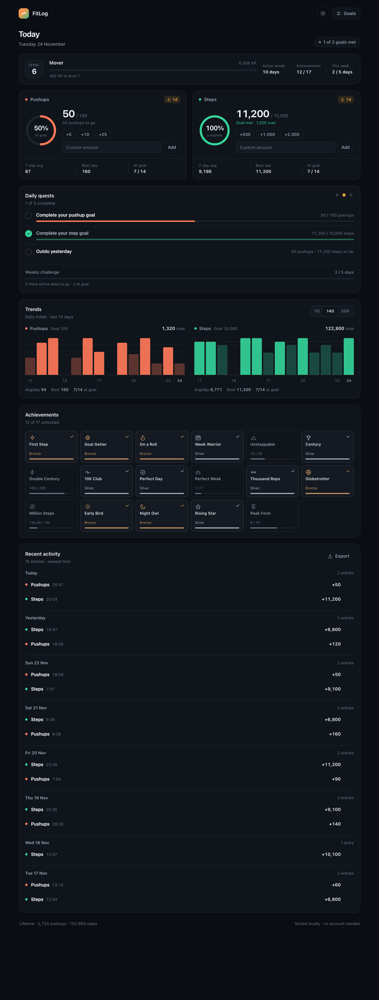
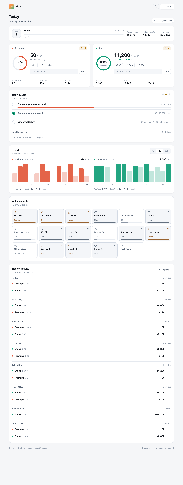

# FitLog

A small, self-hosted fitness tracker for **pushups** and **steps**. It runs on plain
Python with no dependencies to install, stores everything in one SQLite file, and
gives you a browser dashboard with progress rings, streaks, 7/14/30-day trends,
and a motivation layer that rewards consistency.

| Dark | Light |
| --- | --- |
|  |  |

## Features

- Log pushups and steps with one tap (`+5`, `+10`, `+25` / `+500`, `+1,000`, `+2,000`)
  or any custom amount.
- Daily goals with progress rings and "to go" counts.
- Streaks for consecutive days at goal (a day only breaks your streak once it's over).
- 7/14/30-day bar charts with goal lines, hover tooltips, averages, and best days.
- Activity feed grouped by day, with one-click delete and full CSV export.
- XP and levels, three daily quests, a weekly challenge, and 17 achievements.
- Short celebrations for level-ups, unlocked badges, and completed goals — with
  confetti that respects reduced-motion settings.
- Dark and light themes: follows your system by default, toggle in the header.
- Responsive layout, so it works on your phone over Wi-Fi.
- Zero installs, zero accounts, zero network calls.

## Quick start

```sh
cd ~/fitness-tracker
python3 app.py
```

Then open <http://localhost:8756>. To stop it, press `Ctrl+C`.

On macOS you can also double-click **`start.command`** in Finder (the first time,
right-click → Open if Gatekeeper asks).

### Use it from your phone

1. Start with `python3 app.py --host 0.0.0.0`.
2. Find your Mac's IP: `ipconfig getifaddr en0` (Wi-Fi).
3. On your phone (same Wi-Fi), open `http://<that-ip>:8756` and add it to your
   home screen for an app-like shortcut.

Only devices on your local network can reach it. There is no login, so don't
expose it to the internet.

## Where your data lives

Everything is in `fitlog.db` next to `app.py`. To back it up, stop the server and
copy that file. To start fresh, stop the server and delete it (a new empty one is
created on the next start).

Keep the database out of live-synced folders (Dropbox, iCloud Drive, Google Drive)
while the server is running — sync tools can copy a half-written SQLite file. Copy
backups on a schedule instead.

Export a spreadsheet-friendly copy anytime with the **Export CSV** button, or:

```sh
curl -o fitlog.csv http://localhost:8756/api/export.csv
```

## Customizing

- **Goals:** click **Goals** in the header and set pushups/steps targets.
  Defaults are 100 pushups and 10,000 steps.
- **Theme:** follows your OS theme; use the sun/moon button to override. You can
  also force one with `?theme=light` or `?theme=dark` in the URL.
- **Port / host:** `python3 app.py --port 9000 --host 0.0.0.0`.
- **Database path:** set the `FITLOG_DB` environment variable to move it, e.g.
  `FITLOG_DB=/Users/you/Data/fitlog.db python3 app.py`.

## Motivation layer

FitLog turns consistency into visible progress without adding a second system to
maintain. Everything below is computed from your logged entries and goals on each
load — no coins, no streak freezes, and no extra tables.

- **XP and levels.** Each lifetime pushup is 1 XP, each 100 lifetime steps is 1 XP,
  and each active day adds 20 XP. Level thresholds grow quadratically
  (0, 400, 1,000, 1,800, 2,800 XP, ...), with titles from Rookie to Legend.
- **Daily quests.** Complete your pushup goal, your step goal, and one bonus quest
  that rotates daily: outdo yesterday, log three sessions, push 50 past your goal,
  or walk 2,000 extra steps.
- **Weekly challenge.** Stay active five days this week. The bar fills as you log,
  and days at goal are shown alongside it.
- **Achievements.** 17 tiered badges for streaks, lifetime totals, big days, and
  time-of-day habits. Locked badges show progress, so the next milestone is visible.
- **Celebrations.** A short banner and confetti appear only for a level-up, a new
  badge, a completed quest, or both goals done. The confetti is disabled when your
  system asks for reduced motion.

## How it works

No frameworks, no build step, no services to sign up for.

| Layer | Choice | Why |
| --- | --- | --- |
| Server | Python `http.server` (`ThreadingHTTPServer`) | Ships with Python; enough for a personal, single-user app |
| Storage | SQLite via the `sqlite3` module | One portable file; transactional; easy to back up |
| API | Small JSON endpoints in `app.py` | Easy to call from Shortcuts, scripts, or a future mobile client |
| UI | Vanilla HTML/CSS/JS | Instant load, no toolchain, readable in a few files |
| Charts | Hand-built CSS bars and SVG rings | No chart library or CDN, works fully offline |
| Tests | `unittest` against a live temp server | Exercises the real HTTP surface, not just internals |

Data model: one `entries` table (`day`, `kind`, `amount`, `created_at`) plus a
`settings` table for goals. Per-day totals are summed in SQL; streaks, XP, levels,
quests, and achievements are derived on each request, so the schema stays small
and exports remain complete.

## Tests

```sh
python3 -m unittest -v
```

The suite spins up the real server on a random port against a temporary
database and covers logging, validation, deletes, goals, streaks, CSV export,
static file serving, XP/level math, quests, and badge unlocks.

## API

All endpoints return JSON and are served from the same origin as the UI.
Useful if you want to log from a script or Shortcut.

| Method | Path                | Body / query                             | Purpose                         |
| ------ | ------------------- | ---------------------------------------- | ------------------------------- |
| `GET`  | `/api/state`        | `?days=14` (1-365)                       | Today, goals, series, streaks, game |
| `POST` | `/api/entries`      | `{"kind":"pushups","amount":25}`         | Log an entry (optional `"day"`) |
| `DELETE` | `/api/entries/<id>` | —                                      | Remove an entry                 |
| `PUT`  | `/api/settings`     | `{"pushups":120,"steps":10000}`          | Update goals                    |
| `GET`  | `/api/export.csv`   | —                                        | Download all entries as CSV     |

`/api/state` also returns a `game` object with XP, level, quests, badges, and
weekly progress, so scripts or shortcuts can read the same numbers as the UI.

Example:

```sh
curl -X POST http://localhost:8756/api/entries \
  -H 'Content-Type: application/json' \
  -d '{"kind":"pushups","amount":30}'
```

## Project layout

```
fitness-tracker/
├── app.py              # HTTP server, SQLite storage, JSON API, game engine
├── static/
│   ├── index.html      # dashboard shell
│   ├── style.css       # design tokens, light/dark themes, responsive layout
│   └── app.js          # rendering, logging, charts, quests, achievements
├── tests.py            # 36 unit/API tests
├── start.command       # macOS double-click launcher
└── fitlog.db           # created on first run (your data)
```
